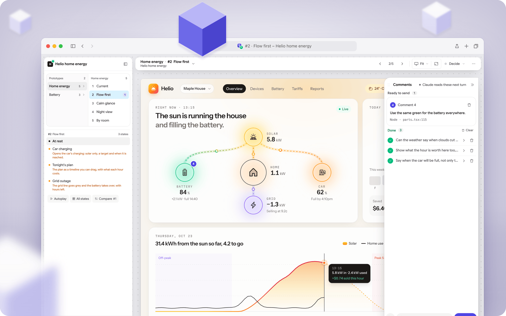
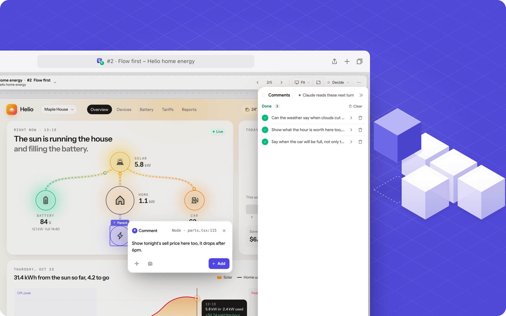

<div align="center">

<picture>
  <source media="(prefers-color-scheme: dark)" srcset="docs/images/icon-light.png">
  
</picture>

# Prototype

**Several live, clickable versions of any UI, built while you watch.**

[](#requirements)
[](LICENSE)
[](#requirements)

[Claude Code](#claude-code) &middot; [Codex](#codex) &middot; [Other agents](#other-agents) &middot; [Features](#features)

</div>

Ask your agent for a few versions of a UI. Prototype opens one live app, builds clickable
variants while you watch, and checks them against your real product. Review them, leave
comments on the design, and choose which one to build into your codebase.

## Requirements

- Node **22.12+** (or a newer supported LTS) and pnpm or npm.
- Chrome, Chromium or Edge for screenshots; terminal, file editing and image viewing in your agent.
- macOS, Linux or Windows. Optional [Tailscale](https://tailscale.com) makes the link reachable on your phone; otherwise use the local URL.

Subagents and image generation are optional. Sandboxed agents need package installation,
access to the preview server, and write access to `<project>/.prototypes/` and `~/.prototypes/`.
A remote container cannot reach a laptop's `localhost` directly.

## Claude Code

Install from the plugin marketplace:

```text
/plugin marketplace add DananzMolt/prototype-skill
/plugin install prototype@prototype-skill
```

Then ask for a prototype:

```text
/prototype the checkout page
/prototype 3 empty states for the inbox
```

Turn on auto-update under `/plugin` → Marketplaces → `prototype-skill`.

<details>
<summary>Install without the plugin system</summary>

```sh
git clone https://github.com/DananzMolt/prototype-skill ~/.claude/skills/prototype
```

Update with `git -C ~/.claude/skills/prototype pull --ff-only`. On Windows, use
`"$HOME\.claude\skills\prototype"` as the clone destination in PowerShell.
</details>

## Codex

Clone the complete repository into the [user skill directory](https://learn.chatgpt.com/docs/build-skills):

```sh
git clone https://github.com/DananzMolt/prototype-skill ~/.agents/skills/prototype
```

Then invoke the skill, or select it in the skill picker:

```text
$prototype 3 alternatives for the checkout page
```

Update with `git -C ~/.agents/skills/prototype pull --ff-only`. Restart Codex if the skill
does not appear. For a project-only install, use `<project>/.agents/skills/prototype`.

<details>
<summary>Windows or an existing Claude installation</summary>

In PowerShell:

```powershell
git clone https://github.com/DananzMolt/prototype-skill "$HOME\.agents\skills\prototype"
```

On macOS or Linux, reuse an existing Claude checkout with a symlink:

```sh
mkdir -p ~/.agents/skills
ln -s ~/.claude/skills/prototype ~/.agents/skills/prototype
```

Use a clone or a symlink at that destination, not both.
</details>

## Other agents

[OpenCode](https://opencode.ai/docs/skills/) also discovers the shared skill directory:

```sh
git clone https://github.com/DananzMolt/prototype-skill ~/.agents/skills/prototype
```

Ask it to use the skill:

```text
Use prototype to build a few versions of the settings drawer.
```

For another agent, install the complete repository in its documented skill directory,
or ask it to read `<checkout>/SKILL.md` and follow it. The agent needs local command execution,
file editing and image viewing. Slash commands and automatic discovery depend on the host.
Copy the whole repository, not just `SKILL.md`.

## Comments and follow-ups

Keep talking in the same conversation and everything lands in the same app:

| You say | You get |
| --- | --- |
| "two more" | D and E next to A, B and C |
| "B, but with a map" | new variants built from B |
| "try other headlines" | copy options you can pick on the design |
| "go with A" | A marked as the pick |
| "build it" | the real feature in your codebase |

You can also send comments and requests from the prototype itself. **Automatic responses
while the agent is idle require background wakeups from the host.** Otherwise comments stay
saved until the next turn; send the agent "check the prototype comments" to pick them up.

## Features

- **Live variants:** one app and link per conversation, with placeholders that fill in as the agent writes. Changes appear without a reload.
- **Your product first:** variant A, "Current", matches today's screen using its real assets, tokens and sizes. Other variants start from it. Supports React and Vue, including Hebrew and Arabic layouts.
- **Design kits:** matched screens, tokens and shared chrome are saved for later sessions. The agent checks whether the real product has changed before reusing them.
- **Review tools:** side-by-side views, focus mode, desktop/tablet/phone layouts, state lists, autoplay and comparison. The agent checks screenshots on desktop and phone, then recommends a direction.
- **Comments, copy and motion:** pin comments and tag elements, try wording options, or scrub animations and comment on a moment or range. A Try it panel can explain inputs and scenarios.

Actions → More like this and a prototype's More variants menu request more directions.
Needs explanation and Generate copy options request review content through the comments
inbox; highlighting text offers copy options and comments for those words. On phones,
these tools live in the variant sheet and pill menu. Right-click opens menus throughout
the app; Shift + right-click keeps the browser menu. Delete a pending request to cancel it.

<p align="center">
<picture>
  <source media="(prefers-color-scheme: dark)" srcset="docs/images/variant-dark.png">
  
</picture>
<br><sub>A variant, with every prototype and variant of the session in the sidebar.</sub>
</p>

<p align="center">
<picture>
  <source media="(prefers-color-scheme: dark)" srcset="docs/images/comments-dark.png">
  
</picture>
<br><sub>Comments on the design go to your agent, who makes the change and replies.</sub>
</p>

## How it works

Apps live in `<project>/.prototypes/<session>/`, git-ignored, and leave your product files
untouched. An app stops after 6 hours with nothing open and restarts on the same link.
Sessions untouched for 14 days are deleted unless you keep them.

<details>
<summary>CLI, session identity and agent recovery</summary>

`proto` in the skill means `node "<installed-skill-dir>/scripts/proto.mjs"`.
From your product folder:

```sh
node ~/.agents/skills/prototype/scripts/proto.mjs up --session checkout-demo --name "Checkout"
node ~/.agents/skills/prototype/scripts/proto.mjs inbox --session checkout-demo
```

The CLI chooses a session from `--session`, `PROTO_SESSION_ID`, `CODEX_THREAD_ID`,
`CLAUDE_CODE_SESSION_ID`, or `CLAUDE_SESSION_ID`, in that order. Without a host ID, the agent
generates a unique ID once and reuses it on every call. Separate conversations use different
IDs. Workers pass the parent's ID and `--project <root>` explicitly. `proto ls` lists sessions
to resume.

New UUID sessions keep the full ID, preventing collisions between time-based Codex IDs.
Existing shortened UUID sessions resume only when the stored full ID matches.

Replies detect Codex or Claude when their identity variables exist; other agents get a
neutral mark. Set `PROTO_AGENT` to `codex`, `claude` or `agent`, or pass `reply --as <agent>`,
to override it. `PROTO_AGENT_PID` can identify a long-lived agent process for interrupted-comment
recovery; never use a short-lived command's PID.

The agent reads `proto inbox` on active turns. A host with background completion wakeups
can also use `proto inbox --wait` to react to comments while idle.
</details>

## Contributing

`SKILL.md` is the workflow, `references/` contains conditional guidance, `scripts/proto.mjs`
runs sessions, and `app/` is the template. Repository instructions live in `AGENTS.md`,
which `CLAUDE.md` imports.

Fast checks, also run in CI:

```sh
node --test .github/agent-checks.mjs
node scripts/proto.mjs stack --project .
```

Full browser regression suite (requires the screenshot dependencies above):

```sh
node .github/smoke.mjs
```

The suite creates temporary apps and cleans up its servers. Syntax and CLI checks alone
cannot verify browser behavior. Issues and pull requests are welcome.

## License

[MIT](LICENSE) © Tomer Danan
