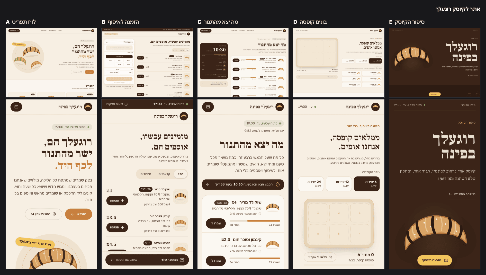
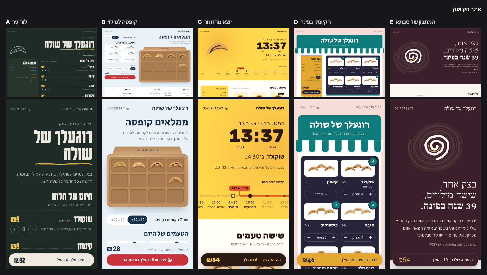
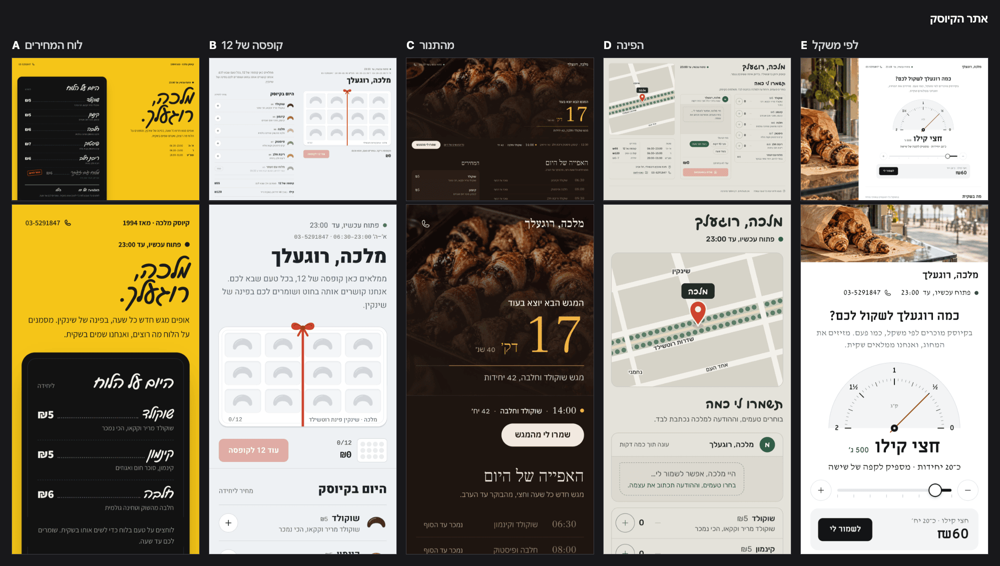

# Before / after: craft.md

Three new-product prompts (`bench/*.txt`), each run once on `main` (f3a5773) and once on this
branch, headless (`claude -p`, Opus, same prompt, the skill loaded with `--plugin-dir`), all six
at the same time. `bench/bench.mjs` times each run from the session folder, once a second.

| Prompt | Arm | Link ready | First variant on screen | All 4 written | Final reply | Cost |
|---|---|---|---|---|---|---|
| Pricing | before | 10 s | 67 s | 3:38 | 3:58 | $1.52 |
| Pricing | after | 11 s | 101 s | 4:41 | 5:09 | $3.13 |
| Landing | before | 10 s | 99 s | 6:03 | 6:28 | $4.39 |
| Landing | after | 12 s | 103 s | 8:17 | 8:36 | $5.57 |
| Sleep app | before | 10 s | 238 s | 7:14 | 8:04 | $4.26 |
| Sleep app | after | 12 s | 133 s | 5:59 | 6:17 | $3.97 |
| **Mean** | before | 10 s | 135 s | | 6:10 | $3.39 |
| **Mean** | after | 12 s | 112 s | | 6:41 (+8%) | $4.22 (+25%) |

One run per arm: the timings are indicative, and the spread between prompts is larger than the
difference between arms. Two processes stayed alive after their final reply (a late scheduled
self-check, a lingering process); "Final reply" is when the last reply was written.

What changed in the output:

- **Pricing.** Before: all four variants in one look, cream paper, a serif headline, a terracotta
  accent (the first default craft.md names). After: four looks taken from what Loomwork does (a
  review canvas with comment pins, a compare sheet, a receipt, a design-tool inspector).
- **Landing.** Before: three cream and condensed-serif pages and one teal. After: four distinct
  looks (a swim-window chart, a lifeguard board with the flag, a dawn notification, a coastline
  map you tap).
- **Sleep app.** Before is the most cohesive (one dark iOS look with a gold accent, four
  layouts). After varies more (a tide line, a light morning report, a dial, one step at a time);
  closer to a tie here.

The isolation check passed: every after session has the font kit and `.proto/briefs/`, no
before session does.

## Round 2: Google Fonts kit, Hebrew, distinct directions, critic, images

One Hebrew prompt (`bench/rugelach.txt`, five variants, all copy in Hebrew), run on main, on the
first commit of this branch, and on round 2.

| Arm | First variant on screen | All written | Final reply | Cost |
|---|---|---|---|---|
| main | 136 s | 8:21 | 8:21 | $5.79 |
| round 1 | 149 s | 11:20 | 11:20 | $8.03 |
| round 2 | 148 s | 15:05 | 15:05 | $11.18 |

- **main:** five layouts in one cream-and-brown look.
- **round 1:** five looks, but the same bottom order bar in all five and a few loud ones.
- **round 2:** five looks with five Hebrew pairings from the draw (Gveret Levin, Frank Ruhl
  Libre with IBM Plex Sans Hebrew, Heebo, Miriam Libre with David Libre, Playpen Sans Hebrew), two
  generated photos (codex-image), one loud direction, no shared order bar, and a critic pass.
  The time and cost went up with the critic and the images: the first variant is no later, the
  whole run is about 80% longer than main.

An existing product (a private app, kept out of this repo) was also run on main and round 2 with a
Current: both kept the product's look, chrome and type; round 2 changed only what the directions
were about.

